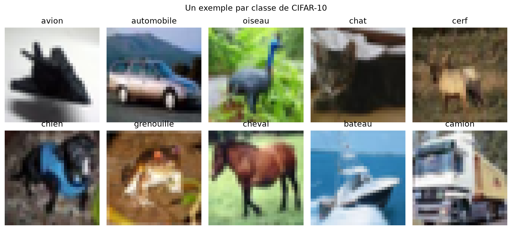
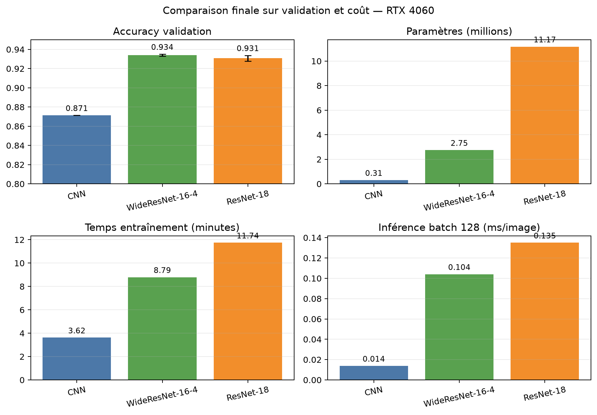
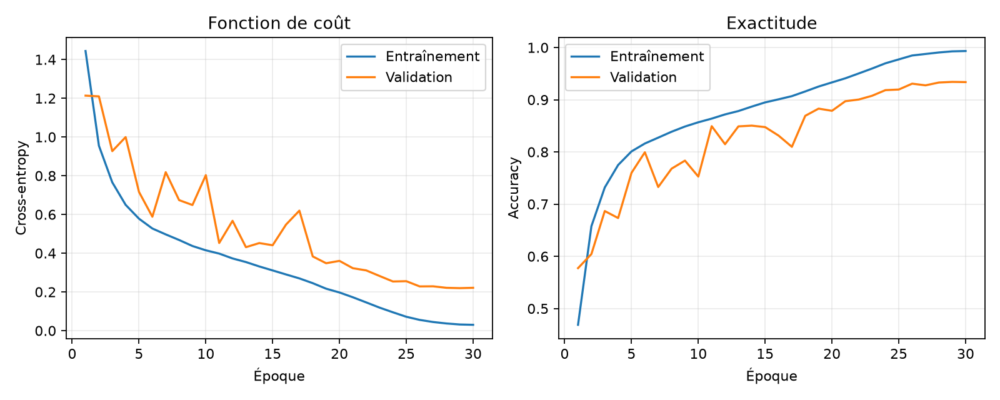
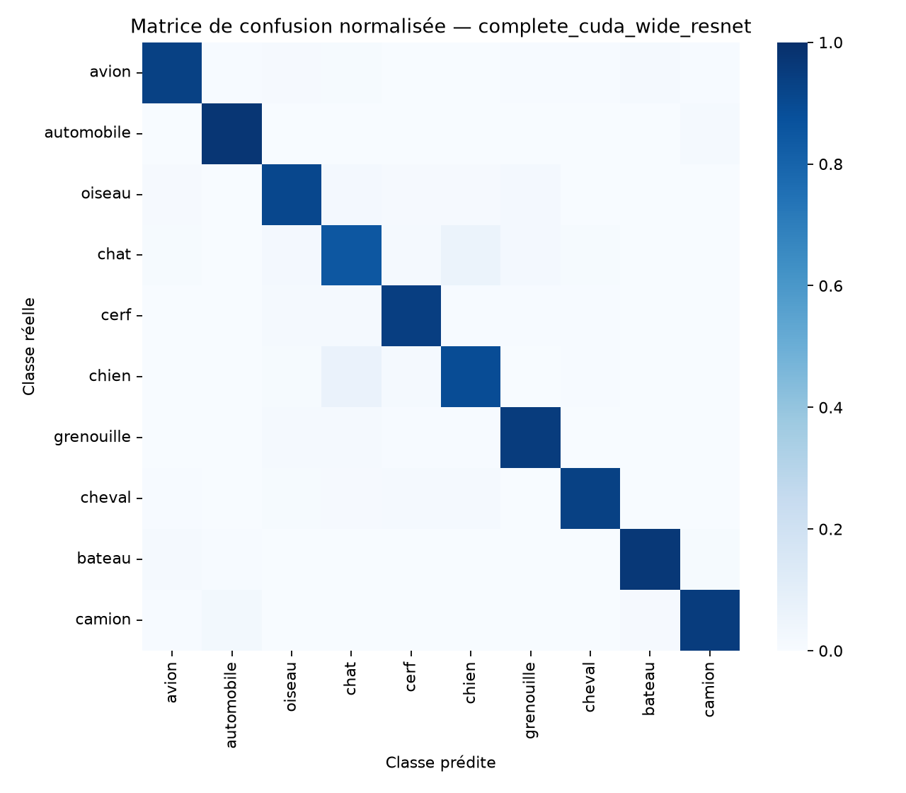
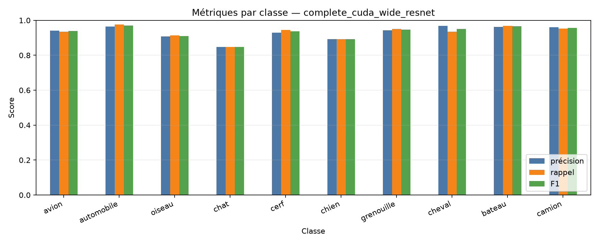
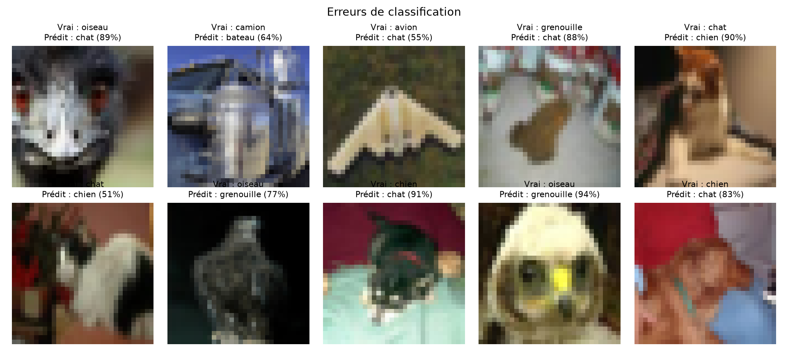

# Classification d'images CIFAR-10

**Projet individuel de Deep Learning — Master 2 Intelligence Artificielle**

**Auteur : Thomas Gassmann — 22 octobre 2026**

## Résumé

J'ai comparé quatre familles de réseaux sur CIFAR-10, depuis un MLP jusqu'à des architectures résiduelles. J'ai d'abord exploré les modèles sur 4 000 images, puis contrôlé trois régularisations ResNet à budget constant et confirmé les finalistes sur 45 000 images. Ma sélection repose exclusivement sur une validation stratifiée de 5 000 images. Sur trois seeds, WideResNet-16-4 obtient **93,40 ± 0,11 %** en validation, devant ResNet-18 (**93,07 ± 0,31 %**), avec environ quatre fois moins de paramètres. Après verrouillage du checkpoint seed 42, j'obtiens **93,16 % d'accuracy et 93,16 % de macro-F1** sur les 10 000 images test. Les principales erreurs opposent chat et chien. Le code, les configurations, les poids finaux, les métriques et leur provenance sont livrés.

## 1. Contexte et objectif

CIFAR-10 est un benchmark de classification supervisée composé d'images RGB 32 x 32. À cette résolution, la faible quantité de pixels et la variabilité de pose ou d'arrière-plan rendent certaines classes visuellement proches. Mon objectif n'est pas seulement d'augmenter l'accuracy : je cherche un modèle dont le gain est démontré par un protocole sans fuite, puis je mesure son coût en paramètres, temps, mémoire et latence.

Je progresse d'une baseline non spatiale vers des convolutions, puis vers des connexions résiduelles. Cette démarche répond au sujet : benchmark sur sous-ensemble, confirmation sur le jeu complet, optimisation contrôlée, évaluations multiples et analyse de qualité.

## 2. Données et absence de fuite

CIFAR-10 contient 60 000 images équilibrées entre dix classes : 50 000 pour l'apprentissage officiel et 10 000 pour le test [1]. Les statistiques que j'ai recalculées sur le train sont μ = (0,49140 ; 0,48216 ; 0,44653) et σ = (0,24703 ; 0,24349 ; 0,26159), cohérentes avec les constantes de normalisation utilisées.

| Partition | Taille | Rôle |
|---|---:|---|
| Train après découpe | 45 000 | Ajustement des poids |
| Validation stratifiée | 5 000 | Checkpoints, modèles et hyperparamètres |
| Sous-ensemble d'optimisation | 4 000 du train | Comparaisons courtes à budget constant |
| Test officiel | 10 000 | Mesure finale après verrouillage |

Je fixe les seeds des générateurs et des workers. Le train reçoit un crop aléatoire avec padding 4 et un retournement horizontal ; validation et test utilisent seulement conversion et normalisation. Le test est construit par une fonction séparée et n'intervient ni dans l'entraînement ni dans la sélection. Chaque classe compte exactement 4 500 exemples de train, 500 de validation et 1 000 de test.

<!-- pagebreak -->

## 3. Modèles et choix méthodologiques

- **MLP** : baseline de 1,71 M de paramètres qui ignore les voisinages spatiaux.
- **CNN personnalisé** : trois blocs convolution–BatchNorm–ReLU, pooling, dropout et moyenne globale ; 305 k paramètres.
- **ResNet-18 CIFAR** : blocs résiduels, stem 3 x 3 sans max-pooling initial afin de préserver les images 32 x 32 [2] ; 11,17 M de paramètres.
- **WideResNet-16-4** : six blocs résiduels et largeur accrue, compromis profondeur/largeur adapté à CIFAR [3] ; 2,75 M de paramètres.

Tous les réseaux apprennent depuis zéro. Je n'utilise pas de préentraînement ImageNet, qui aurait introduit un facteur supplémentaire et une source de données externe. Pour les runs complets, j'emploie une cross-entropy, SGD Nesterov (lr 0,1, momentum 0,9), weight decay 5e-4, batch 128 et annealing cosinus sur 30 époques. Le meilleur checkpoint minimise la perte de validation. Cette règle privilégie une distribution probabiliste correcte plutôt qu'un pic ponctuel d'accuracy.

## 4. Paramétrisation et expériences

Mon exploration historique sur 4 000 images et cinq époques plaçait déjà les réseaux résiduels devant le MLP et le CNN, mais tous progressaient encore : ce classement mesurait surtout la vitesse de convergence. J'ai donc réservé l'analyse finale aux runs complets.

J'ai ensuite comparé trois configurations ResNet-18 sur 4 000 images, dix époques et la seed 42. Un seul facteur change par essai ; le test reste inaccessible.

| Variante | Accuracy validation | Perte validation | Temps |
|---|---:|---:|---:|
| Référence | **31,12 %** | **1,8436** | 65,7 s |
| MixUp seul, α = 0,2 | 30,42 % | 1,8755 | 52,6 s |
| Label smoothing seul, ε = 0,1 | 29,14 % | 1,9904 | 54,8 s |

Ces scores faibles sont attendus pour un ResNet entraîné seulement dix époques avec SGD sur 4 000 images. Ils sont utiles comme ablation relative, pas comme performance finale. Ni MixUp ni le label smoothing n'améliorent la référence ; j'ai donc confirmé honnêtement la référence, sans empiler des régularisations non justifiées.

La traçabilité de chaque run comprend la configuration résolue, la commande, Python, PyTorch, torchvision, CUDA, le GPU, le commit Git, l'état du dépôt et une empreinte SHA-256 du code. Les entraînements actuels utilisent Windows 11, Python 3.12.13, PyTorch 2.14.1+cu132 et une RTX 4060.

<!-- pagebreak -->

## 5. Résultats complets et incertitude

| Modèle | Paramètres | Accuracy validation | Temps | Latence batch 128 | Pic GPU |
|---|---:|---:|---:|---:|---:|
| CNN, n=1 | 305 258 | 87,14 % | 3 min 37 s | 0,0138 ms/img | 364 Mo |
| WideResNet-16-4, n=3 | 2 748 890 | **93,40 ± 0,11 %** | 8 min 47 s ± 9 s | 0,1040 ± 0,0017 ms/img | 1 036 Mo |
| ResNet-18, n=3 | 11 173 962 | 93,07 ± 0,31 % | 11 min 44 s ± 10 s | 0,1350 ± 0,0009 ms/img | 2 269 Mo |

Les écarts-types sont des écarts-types d'échantillon sur les seeds 42, 123 et 2026. WideResNet dépasse ResNet-18 de 0,33 point en moyenne, avec une variance plus faible. L'écart demeure modeste, mais WideResNet possède aussi 75 % de paramètres en moins, s'entraîne environ 25 % plus vite et consomme 54 % de mémoire GPU en moins. Je le retiens donc sur un faisceau cohérent de critères, et non sur un seul meilleur run.

Pour éviter le cherry-picking, je conserve le checkpoint principal seed 42, défini avant les réplications, plutôt que la seed 123 légèrement plus favorable. Son empreinte est `a9f98c2d9394ab450a2c1a97b776bc5641fa07ce78071f9572e71d05c28bf933`.

## 6. Dynamique d'apprentissage

Le WideResNet seed 42 atteint sa meilleure perte à l'époque 29 : 0,2195 pour 93,42 % de validation. L'accuracy train atteint alors 99,27 %, soit un gap d'environ 5,9 points. La forte augmentation et la décroissance cosinus contiennent ce surapprentissage sans l'annuler. Les oscillations de validation avant l'époque 20 montrent l'intérêt de conserver le meilleur checkpoint ; la baisse du learning rate stabilise nettement les dix dernières époques.

<!-- pagebreak -->

## 7. Évaluation finale sur le test

Après sélection de l'architecture et verrouillage du checkpoint, j'ai évalué le test officiel. La matrice contient 10 000 prédictions et chaque ligne a un support de 1 000. Une répétition technique après verrouillage a redonné exactement la même matrice et les mêmes métriques ; elle n'a déclenché aucune modification de modèle.

| Métrique test | Valeur |
|---|---:|
| Accuracy | **93,16 %** |
| Précision macro | 93,17 % |
| Rappel macro | 93,16 % |
| Macro-F1 | **93,16 %** |
| Negative log-likelihood | 0,2269 |
| Confiance moyenne | 95,76 % |
| ECE, 15 bins | 2,65 % |

Le test est inférieur de 0,26 point à la validation seed 42, écart faible et cohérent avec une bonne généralisation. La confiance moyenne dépasse l'accuracy de 2,60 points et l'ECE vaut 2,65 % : le modèle est légèrement surconfiant. Je ne calibre pas a posteriori sur le test ; une calibration future devrait être ajustée sur validation.

## 8. Analyse par classe et erreurs

Les meilleures classes sont automobile (F1 96,97 %), bateau (96,56 %), camion (95,58 %) et cheval (95,17 %). Les classes les plus difficiles sont chat (84,80 %), chien (89,30 %) et oiseau (91,07 %). Les principales confusions sont chien → chat (69 images) et chat → chien (61), puis camion → automobile (24). Cela correspond à des ressemblances de texture, de posture et d'arrière-plan amplifiées par la résolution 32 x 32.

Les images ci-dessous sont les dix premières erreurs du test, sans sélection esthétique. Plusieurs sont très confiantes : oiseau → chat à 89 ou 91 %, grenouille → chat à 88 %, chat → chien à 90 %, oiseau → grenouille à 94 %. Leur ambiguïté confirme la légère surconfiance mesurée.

## 9. Coût, responsabilité et déploiement

Le benchmark modèle seul effectue dix batches de warm-up, synchronise CUDA et mesure cinquante batches. En batch 1, WideResNet demande 2,016 ± 0,080 ms/image, p95 2,194 ms et 296 Mo de pic GPU. En batch 128, il demande 0,1045 ± 0,0035 ms/image, p95 0,1099 ms et 690 Mo. L'entraînement complet culmine à 1 036 Mo. Je distingue ces valeurs du temps end-to-end test (1,176 ms/image en batch 256), qui inclut chargement et transfert.

WideResNet est mon meilleur compromis responsable dans le périmètre testé : il égale ou dépasse ResNet-18 avec quatre fois moins de paramètres et moins de calcul. Je ne fournis toutefois pas de mesure d'énergie ; je ne transforme donc pas ce constat matériel en affirmation environnementale quantitative.

Pour un déploiement, j'intégrerais la normalisation à la chaîne d'entrée, conserverais une sortie softmax documentée et surveillerais dérive et calibration. TorchScript ou ONNX, la quantification et la latence sur la cible réelle restent à valider : je ne les présente pas comme exécutés. Dans un contexte à enjeu, je prévoirais un seuil de confiance, une classe de rejet et une revue humaine. CIFAR-10 reste un benchmark académique ancien et simplifié, non représentatif des biais et contraintes d'un système réel.

## 10. Limites et retour réflexif

Mon étude est limitée à CIFAR-10, 30 époques, trois seeds pour deux finalistes et un seul GPU. `deterministic=false` fixe les générateurs mais autorise certains algorithmes CUDA non déterministes ; la réplication mesure partiellement cette variabilité. Je n'ai pas réalisé de recherche bayésienne, de test-time augmentation, de transfert ImageNet ni de calibration post-hoc, car leur coût ou leurs facteurs supplémentaires auraient dilué les exigences centrales du sujet.

Ce projet m'a conduit à distinguer trois niveaux souvent confondus : présence du code, bon fonctionnement vérifié et conclusion scientifiquement soutenue. J'ai renforcé ma pratique du découpage sans fuite, des ablations à un facteur, de la traçabilité des checkpoints et de l'analyse performance/coût. Sur le plan professionnel, je retiens qu'un modèle légèrement meilleur mais beaucoup plus coûteux n'est pas automatiquement le bon choix, et qu'un livrable reproductible vaut autant que son score isolé.

## 11. Conclusion

J'ai satisfait la démarche demandée en comparant plusieurs modèles sur sous-ensemble, en contrôlant des régularisations, en confirmant sur les données complètes et en réservant le test à la fin. WideResNet-16-4 est le meilleur choix dans mon protocole : **93,16 % d'accuracy test**, 2,75 M de paramètres et une latence batch 1 proche de 2 ms sur RTX 4060. Les erreurs résiduelles concernent surtout chat, chien et oiseau ; la calibration, l'évaluation sur données décalées et l'export vers une cible réelle constituent les prochaines étapes prioritaires.

## Références et outils

- [1] A. Krizhevsky, V. Nair, G. Hinton, *The CIFAR-10 dataset*, University of Toronto, https://www.cs.toronto.edu/~kriz/cifar.html.
- [2] K. He, X. Zhang, S. Ren, J. Sun, “Deep Residual Learning for Image Recognition,” CVPR 2016, https://arxiv.org/abs/1512.03385.
- [3] S. Zagoruyko, N. Komodakis, “Wide Residual Networks,” BMVC 2016, https://arxiv.org/abs/1605.07146.
- [4] H. Zhang et al., “mixup: Beyond Empirical Risk Minimization,” ICLR 2018, https://arxiv.org/abs/1710.09412.
- [5] PyTorch et torchvision, documentation officielle, https://pytorch.org/docs/stable/.
- [6] OpenAI Codex, utilisé comme assistant pour l'audit, la robustesse du code, la rédaction et l'interprétation des résultats. Je l'ai laissé suivre les journaux d'entraînement pendant les époques afin de relever tendances et incidents ; les valeurs finales proviennent exclusivement des artefacts vérifiés du dépôt. Le nom exact du modèle de service doit être repris depuis l'interface si l'établissement l'exige.
